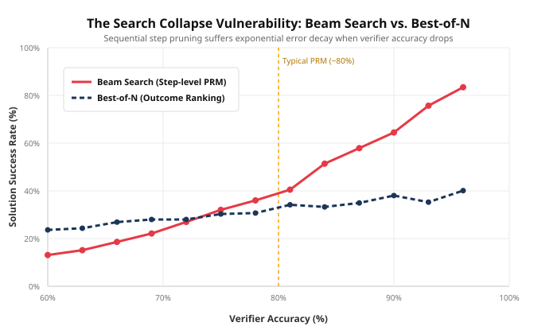

# Research Probes: Empirical Dissections of Frontier AI

Independent empirical probes, reproduction experiments, and failure-mode analyses of frontier AI preprints in **Test-Time Compute, Reasoning Search & Verification**.

Authored by **Tushar** ([GitHub](https://github.com/tushar152006))

---

## Sprint 01: The Search Collapse Vulnerability in Test-Time Search

- **Paper Dissected**: *Scaling LLM Test-Time Compute Optimally can be More Effective than Scaling Model Parameters* (Snell et al., UC Berkeley / Google DeepMind, [arXiv:2408.03314](https://arxiv.org/abs/2408.03314))
- **Key Finding**: In step-level Beam Search with a Process Reward Model (PRM), errors compound multiplicatively across sequential reasoning steps ($\alpha^d$). When verifier accuracy drops below the analytical threshold:
  $$\alpha^* = \left(1 - (1 - p^d)^N\right)^{\frac{1}{d-1}} \approx \mathbf{73.9\%}$$
  Beam Search plummets to **13.1%**, while naive Best-of-N remains resilient at **23.6%**.

---

### Empirical Results (2,000 Monte Carlo Trials)

```
============================================================
Verifier Accuracy (α) | Best-of-N Win%     | Beam Search Win%  
============================================================
                 60% |            23.6% |            13.1%  <-- Beam Search collapses
                 66% |            26.9% |            18.6%
                 72% |            28.0% |            27.0%
------------------- CROSSOVER THRESHOLD (~74%) -------------
                 75% |            30.3% |            32.0%
                 84% |            33.2% |            51.4%
                 96% |            40.1% |            83.5%  <-- Beam Search dominates
============================================================
```



---

### Reproduction
Run the zero-dependency simulation:
```bash
python 02_experiments/sprint_01_search_collapse.py
```
Outputs the empirical results table and exports the vector graphic to `02_experiments/search_collapse_curve.svg`.

---

### Repository Structure
```
├── 02_experiments/
│   ├── sprint_01_search_collapse.py   # Pure Python simulation (zero dependencies)
│   └── search_collapse_curve.svg       # Generated vector plot
├── 03_drafts/
│   └── sprint_01_draft.md             # Full technical breakdown & derivations
├── .gitignore
└── README.md
```

---

## Contact & Collaborations
If you are researching inference-time compute scaling, verifier dynamics, or tree-search architectures, feel free to open an issue or reach out.
